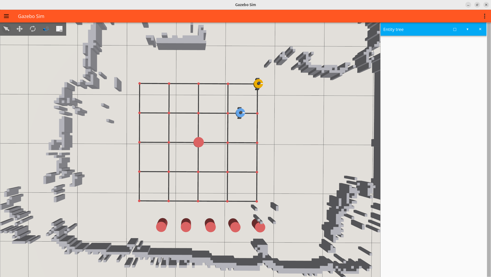
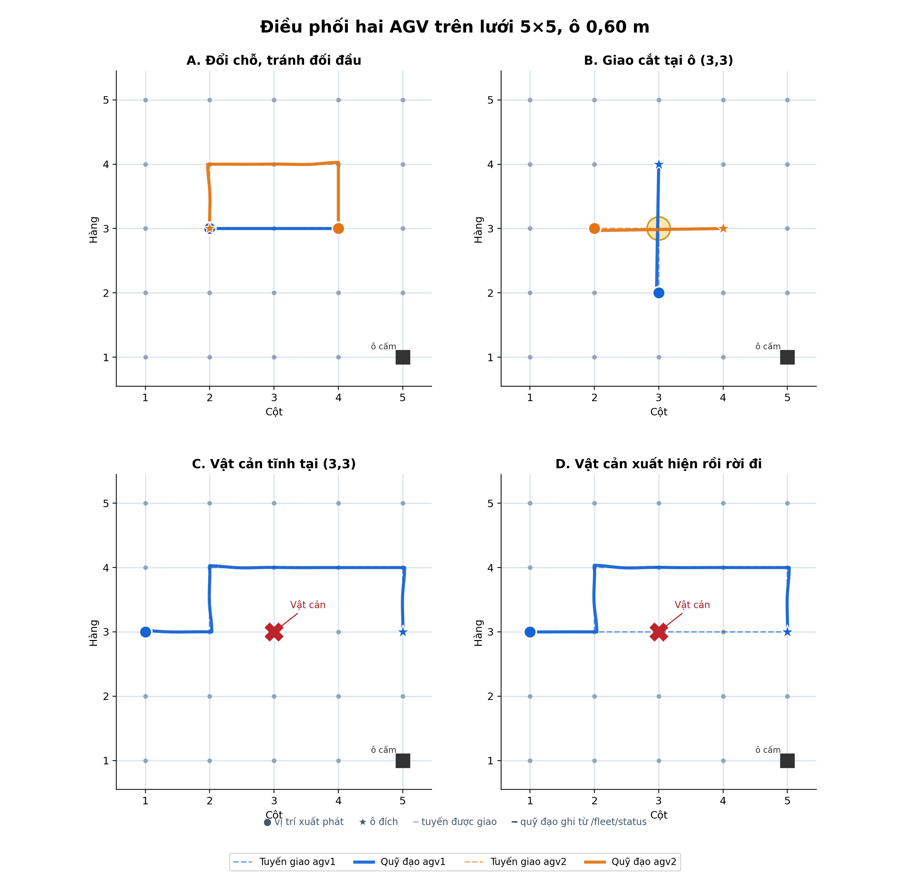
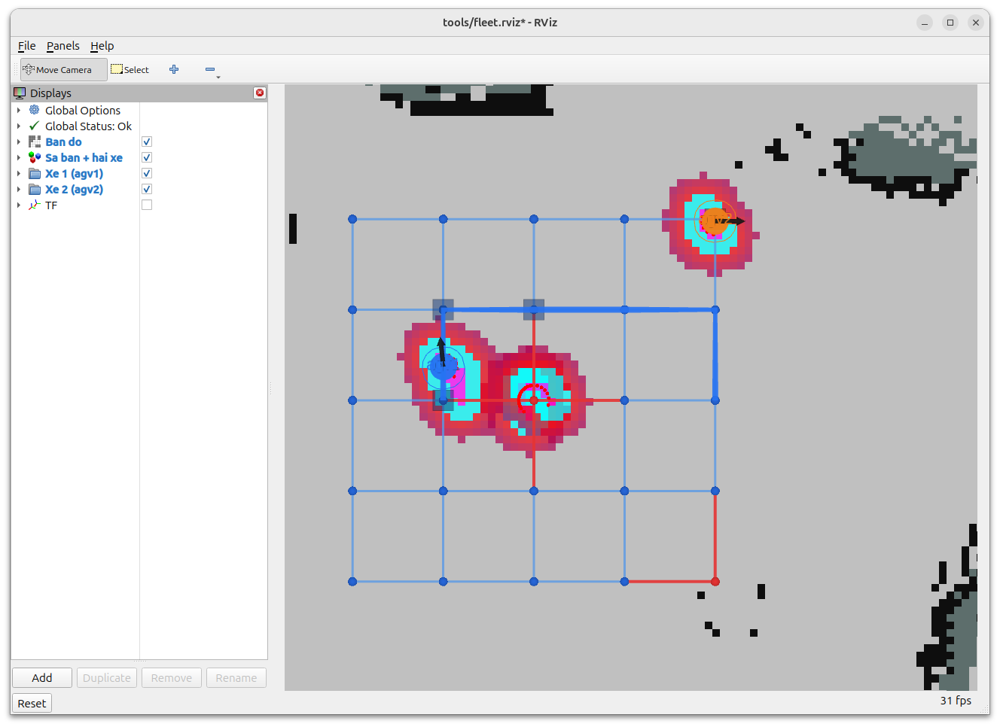
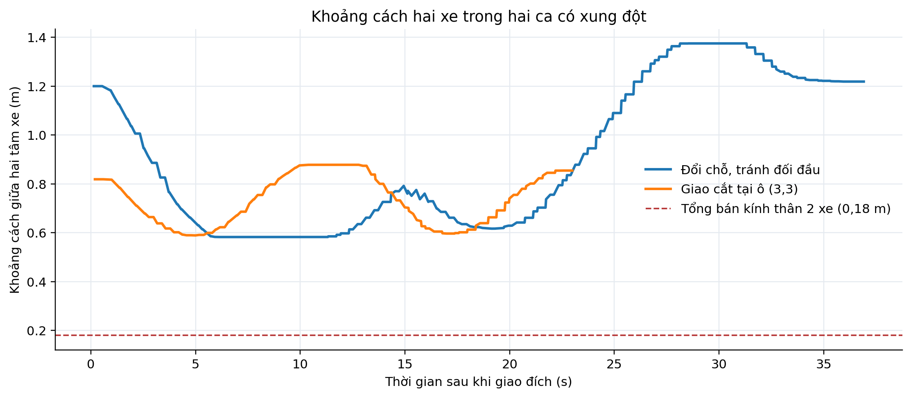

# 2.8. Mô phỏng và công cụ vận hành

## 2.8.1. Mô phỏng tìm đường và điều phối hai robot

Để đánh giá thuật toán trước khi thử trên xe thật, nghiên cứu xây dựng mô phỏng hai AGV trên bản đồ phòng và lưới vận chuyển 5 × 5 ô của hệ thống thực. Khoảng cách giữa hai tâm ô kề nhau là 0,60 m; hàng tăng theo chiều từ dưới lên và cột tăng từ trái sang phải trên sa bàn. Bản đồ được đối chiếu với lưới trước khi lập đường: trong lần thử này, 24/25 ô và 38/40 cạnh hợp lệ; ô (1,5) và hai cạnh sát vật cản bị loại theo ngưỡng an toàn của chương trình.

Mỗi AGV được mô phỏng bằng mô hình động học nhận lệnh vận tốc `/cmd_vel`, có độ trễ lệnh và quán tính bậc nhất. LiDAR ảo phát 360 tia, thấy xe còn lại và các vật cản đưa vào qua `/sim/obstacles`. Hai xe dùng **hai bộ Nav2 riêng** và hai `fleet_agent.py` riêng; bộ điều phối `traffic_manager.py` nhận trạng thái cả hai rồi cấp đường và quyền đi qua các ô. Gazebo thể hiện bản đồ, hai xe và các trụ vật cản trong không gian 3D; vị trí xe trên Gazebo được đồng bộ từ mô hình động học. Vì vậy, kết quả điều hướng ở đây được tính bởi thuật toán ROS 2/Nav2 của dự án, còn Gazebo chủ yếu là công cụ hiển thị và nhập vị trí vật cản, **không phải mô phỏng động lực học va chạm đầy đủ**.

**Hình 2.21.** Môi trường mô phỏng hai AGV trên lưới 5 × 5 ô, với trụ đỏ được đặt tại ô (3,3). Xe 1 màu xanh, xe 2 màu cam; ảnh chụp trực tiếp từ Gazebo trong lần chạy thử.

Thuật toán tìm đường trong bộ điều phối là **Dijkstra trên trạng thái (ô, hướng di chuyển)**. Mỗi cạnh lưới có chi phí cơ sở; thao tác rẽ, đi vào tuyến còn lại của xe khác hoặc đi ngược chiều trên cùng cạnh được cộng chi phí. Các ô/cạnh không an toàn trên bản đồ và vật cản đang được phát hiện bị loại khỏi đồ thị. Cách tính này cho phép chọn đường ngắn, ít rẽ khi không có xung đột, đồng thời chấp nhận đường dài hơn để tránh xe kia. Bộ điều phối cho mỗi xe giữ trước tối đa hai ô trên tuyến; ô đang bị chiếm hoặc đã giữ không được cấp đồng thời cho xe còn lại. Khi hai xe cùng xin một ô, xe còn ít ô tới đích hơn được ưu tiên; khi bị chặn kéo dài, xe phải chờ, đổi tuyến hoặc nhường đường. Nav2 chỉ nhận các đoạn đường đã được bộ điều phối cho phép.

Để kiểm tra những quy tắc trên, nghiên cứu cho chạy **một lần mỗi tình huống** với cùng bản đồ và ghi trực tiếp `/fleet/status`, `/fleet/agv1/cmd`, `/fleet/agv2/cmd`. Trong bảng dưới, “thời gian đến vùng đích” tính từ khi giao lệnh đến lúc các xe nằm trong bán kính 7 cm quanh ô đích liên tục 2 giây. Đây là tiêu chí thu thập dữ liệu mô phỏng, không phải phép đo sai số dừng cuối cùng của Nav2 hoặc xe thật.

| Tình huống | Vị trí đầu → ô đích | Kết quả quan sát | Thời gian (s) |
|---|---|---|---:|
| Đổi chỗ, đối đầu | Xe 1 (3,2) → (3,4); xe 2 (3,4) → (3,2) | Xe 2 đi vòng qua (4,4)–(4,3)–(4,2); xe 1 chờ ô xe 2 giữ rồi đi tiếp. Khoảng cách hai tâm nhỏ nhất 0,582 m. | 37,1 s |
| Giao cắt | Xe 1 (2,3) → (4,3); xe 2 (3,2) → (3,4) | Hai tuyến cùng qua (3,3); xe 2 chờ để xe 1 qua trước. Khoảng cách hai tâm nhỏ nhất 0,589 m. | 23,1 s |
| Vật cản tĩnh | Xe 1 (3,1) → (3,5); xe 2 đỗ tại (5,5) | Đặt trụ tại (3,3) trước khi giao lệnh; xe 1 lập ngay tuyến vòng qua hàng 4. | 39,1 s |
| Vật cản xuất hiện rồi biến mất | Xe 1 (3,1) → (3,5); xe 2 đỗ tại (5,5) | Tuyến đầu đi thẳng qua (3,3). Vật cản xuất hiện sau 8,1 s; chương trình lập lại đường qua hàng 4, sau đó vật cản được gỡ ở 18,1 s. | 44,8 s |

**Hình 2.22.** Tuyến được bộ điều phối giao (nét đứt) và quỹ đạo thực tế của xe ảo lấy từ `/fleet/status` (nét liền) trong bốn tình huống. Dấu tròn là vị trí đầu, ngôi sao là ô đích; dấu X là vật cản. Ở ca D, nét đứt đi qua (3,3) là tuyến ban đầu, còn quỹ đạo thực tế vòng qua hàng 4 sau khi phát hiện vật cản.

Trong ca đổi chỗ, xe 2 được giao tuyến vòng qua hàng 4 ngay khi có xung đột đường đi; xe 1 tạm dừng trước ô đang được xe 2 giữ. Trong ca giao cắt, cả hai tuyến đều đi qua (3,3) nhưng bộ điều phối cấp quyền ô này theo thứ tự, nên hai xe không cùng tiến vào ô. Hình 2.23 minh họa trường hợp xe 1 gặp vật cản mới: điểm LiDAR tại (3,3) khiến đường thẳng không còn được chấp nhận, và tuyến điều hướng chuyển lên hàng 4. Vật cản được đưa vào mô phỏng bằng tọa độ, tồn tại 10 giây rồi được gỡ; thí nghiệm này kiểm tra **vật cản xuất hiện rồi biến mất**, chưa mô phỏng quỹ đạo một người đi ngang qua xe.

**Hình 2.23.** RViz tại thời điểm xe 1 phát hiện vật cản mới ở ô (3,3) và nhận tuyến vòng qua hàng 4; xe 2 đang đỗ tại (5,5). Điểm màu đỏ gần vật cản là phản hồi LiDAR ảo, đường xanh đậm là tuyến xe 1 được giao.

**Hình 2.24.** Khoảng cách giữa hai tâm xe tính từ dữ liệu trạng thái mô phỏng trong ca đổi chỗ và giao cắt. Giá trị nhỏ nhất lần lượt là 0,582 m và 0,589 m, lớn hơn tổng bán kính thân hai xe mô phỏng là 0,18 m. Giá trị này chỉ chứng minh hai mô hình thân xe không chồng lấn trong hai lần thử đã ghi, không thay thế đánh giá an toàn trên xe thật.

Các ảnh và số liệu trên cho thấy bộ điều phối thực thi được ba hành vi cốt lõi: thay đường khi có xung đột hoặc vật cản, cấp quyền ô giao nhau theo thứ tự, và tiếp tục dẫn đường sau khi vật cản xuất hiện. Giới hạn của phép thử là một lần chạy cho mỗi tình huống, định vị xe ảo lý tưởng (`map = odom`), chưa đưa sai số AMCL, trượt bánh hoặc mô hình va chạm vật lý vào đánh giá. Độ chính xác vị trí/góc ở đích và xác suất thành công cần được xác định riêng bằng nhiều lần thử trên xe thật.
