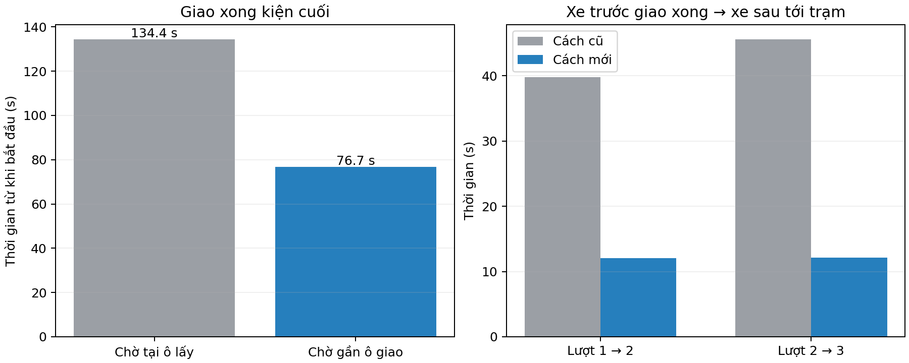

# Cấp hàng vào ô giao theo hàng chờ gần trạm

Chương trình mặc định dùng chế độ `staged`: xe đã lấy hàng cùng đi về vùng
chờ gần ô giao. Mỗi loại có một hàng chờ FIFO theo thời điểm nạp xong và đăng
ký giao; chỉ xe đầu hàng được vào trạm. Những xe khác có đích chờ riêng,
không cùng nhận đích là ô giao đang có người sử dụng.

Xe vào từ phía Bắc của ô giao, đi ra hướng Đông. Hàng 1 đi một chiều sang
Đông rồi thoát lên lưới tại cột 5. Xe sau được cấp quyền khi xe trước đã đi
qua biên giữ chỗ theo hướng ra thêm 2 cm: với bước lưới 0,60 m và bán kính
xe 0,13 m, khoảng này là **hơn 0,45 m tính từ tâm ô giao**. Xe trước tiếp tục
quay về lấy hàng hoặc về ô đỗ; việc quay về không giữ quyền ô giao nữa.

Đây là biện pháp giảm chờ và tránh đối đầu tại trạm; chưa có chứng minh tối
ưu toàn cục hoặc bảo đảm gỡ mọi bế tắc khi tăng số xe.

## So sánh cùng kịch bản ba xe chở T2

Hai lượt cùng ba xe, mỗi xe một kiện T2; cùng vị trí đầu, loại hàng, vận tốc
đặt 0,22 m/s và mô hình cảm biến. Cách cũ chờ ở ô lấy và trả quyền ô giao khi
quay về ô quan sát. Cách mới có vùng chờ gần trạm và luồng ra một chiều.

| Chỉ tiêu | Cách cũ (`serial`) | Cách mới (`staged`) |
|---|---:|---:|
| Kiện giao thành công | 3/3 | 3/3 |
| Từ bắt đầu nhiệm vụ đến giao xong kiện cuối | 134,351 s | 76,700 s |
| Xe trước giao xong → xe sau tới trạm, lượt 1 → 2 | 39,800 s | 12,050 s |
| Xe trước giao xong → xe sau tới trạm, lượt 2 → 3 | 45,600 s | 12,150 s |
| Cảnh báo hai tâm xe gần dưới 0,26 m | 0 | 0 |

Thời gian giao xong kiện cuối giảm **42,91% trong cặp thử này**. Không coi đây
là mức cải thiện trung bình nhiều lượt hay kết quả xe thật. Thứ tự phục vụ
giữa các xe có thể khác vì chế độ mới dùng hàng chờ theo thời điểm sẵn sàng.

Phạm vi kiểm chứng mới: ba xe cùng giao T2 và các kiểm tra mã nguồn về FIFO,
giữ quyền ô, khoảng cách trả quyền, tiến hàng chờ và luồng đường một chiều.
Phép kiểm tra bổ sung chu trình 12 kiện nhiều loại chưa chạy được: Nav2 xe 3
kẹt khi khởi tạo node ROS trước lúc bắt đầu nhiệm vụ. Vì vậy không khẳng định
chế độ mới đã hoàn thành lại 12 kiện; số liệu 12 kiện ở thư mục kiểm chứng
trước thuộc chế độ cũ, được giữ nguyên.



Trong chế độ mới, sau khi xe trước qua biên an toàn, bộ điều phối cấp quyền
cho xe sau trong 0,001 s và 0,050 s ở hai lần chuyển lượt. Đây là **thời gian
cấp quyền trong chương trình**, không phải thời gian xe di chuyển vào ô.
Khoảng 12 giây trong bảng gồm xe trước xoay/đi ra và xe sau đi vào, xác nhận
đích. Các xe vẫn chịu kiểm tra vật cản và giữ chỗ của bộ điều phối giao thông.

Không so trực tiếp thời gian kết thúc toàn bộ vòng quay về: cách cũ kết thúc
ở ô quan sát, cách mới đưa xe hết hàng về ô đỗ cột 1. Chỉ tiêu chính ở đây
có cùng mốc kết thúc là giao thành công kiện cuối.

## Chạy lại và đối chiếu

```bash
cd /home/tai/Robot_kho_clone

# Hiển thị Gazebo và camera, ba xe cùng chở T2.
./tools/warehouse_sim.sh up --autostart --orders 'agv1:2;agv2:2;agv3:2'

# Dừng lượt đang mở trước khi chạy lượt khác.
./tools/warehouse_sim.sh down

# So sánh bằng hai lượt không mở cửa sổ, cùng Nav2 và cảm biến ảo.
# Đổi thư mục --out nếu các thư mục này đã có kết quả cũ.
./tools/warehouse_sim.sh up --headless --no-gazebo --autostart --exit-on-complete \
  --orders 'agv1:2;agv2:2;agv3:2' --delivery-mode serial --out /tmp/delivery_serial
./tools/warehouse_sim.sh up --headless --no-gazebo --autostart --exit-on-complete \
  --orders 'agv1:2;agv2:2;agv3:2' --delivery-mode staged --out /tmp/delivery_staged
source tools/setup_real_env.bash
python3 tools/compare_delivery.py /tmp/delivery_serial /tmp/delivery_staged \
  --out /tmp/delivery_comparison
```

`comparison.json` chứa số liệu tính từ log. Các file có tiền tố `serial_` và
`staged_` là bản sao kết quả đầu vào: `events.jsonl`, `trajectories.csv`,
`scenario.json`, `summary.json`, `audit.json`. Không thay thế hoặc sửa số liệu
của lượt mô phỏng 12 kiện trước đây trong `docs/warehouse_sim_validation/`.
