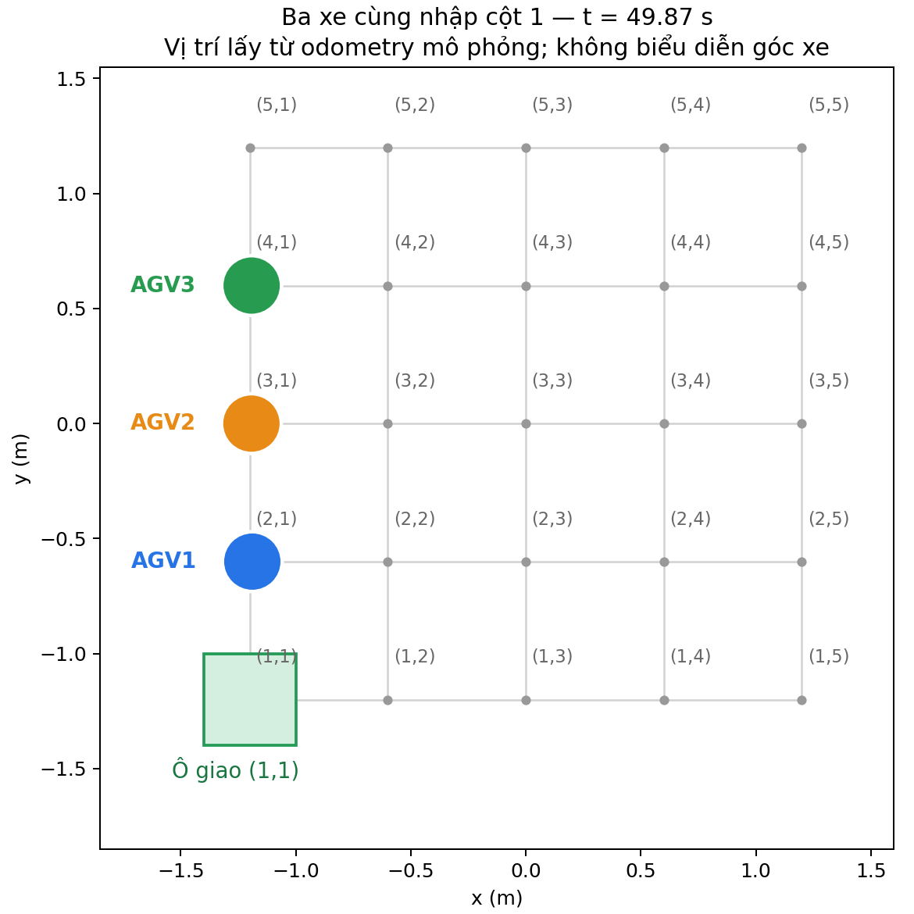
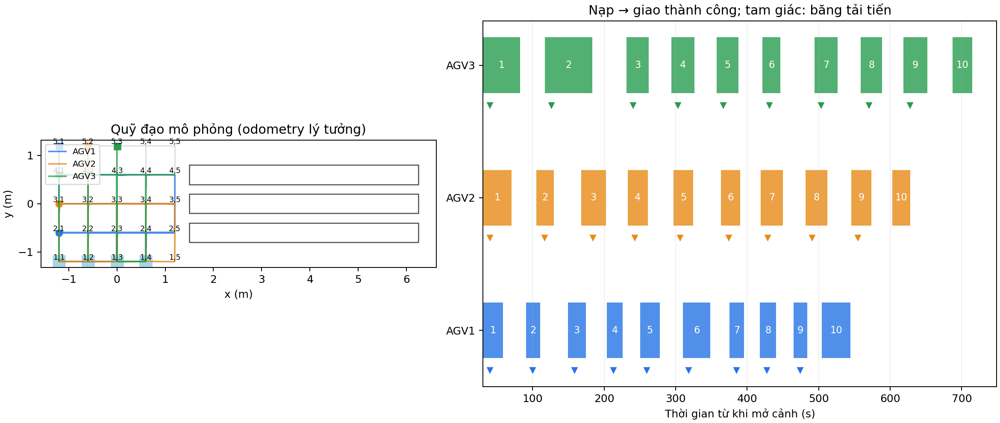

# Nối đuôi trên cột giao và chọn đường về linh hoạt

Ba xe cùng giao T1 vào (1,1) cùng nhập cột 1 tại (2,1), (3,1), (4,1), rồi
tiến theo khoảng trống. Mỗi xe giữ một đích ô giao. Mở quyền đi tiếp dùng
cùng lộ trình, không chuyển qua các ô chờ ở cột khác hoặc hủy FollowPath
chỉ để mở hàng. Các ý định đã được camera phân loại được đăng ký theo vị
trí nhập cột trong cùng chu kỳ, sau đó giữ thứ tự. Chỉ xe đã nạp xong mới
đi giao; không có rào đợi đủ ba xe nạp xong.

Sau khi giao, gửi thẳng đích quay về ô quan sát, hoặc ô đỗ khi hết hàng.
Không bắt buộc sang Đông hoặc tới một ô thoát trung gian. Có thể chọn Tây,
Đông hoặc cùng cột nếu không có xe khác đi vào đó. Khi ra khỏi vùng giữ ô
hơn 0,45 m theo hướng thực tế, trả quyền trạm; quyền ô đường vẫn kiểm tra.

Đồ thị xét cả ô và hướng. Chi phí mô phỏng gồm quãng đường/vận tốc, thời
gian khởi động xoay, góc quay và chờ ước lượng do tranh chấp; tính cả hướng
cuối tại ô quan sát. `route_time_costs` là trọng số lập kế hoạch, không phải
số liệu đo. Chưa chứng minh tối ưu thời gian toàn cục cho mọi lịch đội xe.

## Kiểm chứng bản cuối: 30 kiện

```bash
./tools/warehouse_sim.sh up --scenario demo30 --headless --autostart \
  --exit-on-complete \
  --out /home/tai/agv_logs/warehouse_flexible30_20261024_v1
python3 tools/warehouse_report.py \
  /home/tai/agv_logs/warehouse_flexible30_20261024_v1
```

Gazebo server, ba Nav2, ba camera RGB tổng hợp và LiDAR phân tích; không mở
GUI. Mỗi xe giao 10 kiện rồi đỗ, không dùng `--sync-rounds`.

| Chỉ tiêu từ chính lượt chạy | Kết quả |
|---|---|
| Giao thành công | 30/30; mỗi xe 10/10 |
| Camera chốt, đối chiếu đúng loại | 30/30 |
| Kiện rời băng tải nhận | 30/30 |
| Cấp kiện sau khi nạp và rời vùng lấy | 27 lần |
| Đăng ký lộ trình nhập cột | 30 lần |
| Đích thoát trung gian `exiting` | 0 |
| Rời trạm sang Đông / Tây / Bắc | 7 / 5 / 18 lần |
| Lỗi FIFO, quyền trạm, giao sai ô hoặc xe chưa nạp được vào trạm trong audit | 0 |
| Bắt đầu → giao kiện cuối | 706,800 giây |
| Bắt đầu → cả ba đỗ xong | 727,500 giây |
| Khoảng cách tâm nhỏ nhất ghi nhận | 0,590027 m |
| Cảnh báo khoảng cách tâm dưới 0,26 m | 0 |
| Kiểm tra tự động | 163/163 đạt |

Hướng rời trạm suy ra từ mẫu vị trí gần thời điểm trả quyền, bao gồm đi lấy
tiếp và đi đỗ. Audit giữ từng mẫu và thời điểm để đối chiếu, không coi số
lần rẽ là chứng minh đã tối ưu toàn cục.



Hình dựng từ [mẫu odometry của chính lượt 30 kiện](first_column_snapshot.json)
tại **49,873 giây sau khi mở cảnh**. Ba xe đang chở kiện đầu, gần (2,1),
(3,1), (4,1); lệch ngang so với cột dưới 2 cm ở mẫu này. Hình biểu diễn vị
trí, không phải ảnh Gazebo và không biểu diễn góc xe.



Nguồn: [sự kiện](flexible30/events.jsonl), [summary](flexible30/summary.json),
[audit](flexible30/audit.json), [quỹ đạo CSV](flexible30/trajectories.csv),
[log điều phối](flexible30/traffic.log), [cấu hình](flexible30/grid.yaml),
[mã băm](flexible30/code_sha256.json).

`delivery_admitted.wait_s` trong log gốc là tuổi ý định từ khi phân loại và
đăng ký, gồm tiếp cận/nạp hàng; không phải thời gian xe đứng chờ.
`ready_to_admit_delay_s` của audit dùng thời điểm đã nạp xong khi tính bàn giao.

## Phân biệt các lượt trước

`six_gui/` giữ lượt có Gazebo, RViz và camera: mỗi xe giao T1 rồi T4, đạt
6/6. Lượt đó kiểm tra nối đuôi nhưng **vẫn dùng đích thoát cố định trước khi
yêu cầu được làm rõ**; không coi là kiểm chứng bản đường về linh hoạt có GUI.
Bản cuối được kiểm chứng bằng lượt 30 kiện phía trên.

Các lượt bị dừng không được tính hoàn thành. `../warehouse_waiting_validation/`
là cách chọn ô chờ rời rạc trước đó, giữ làm lịch sử và đã được thay thế.

Đây là mô phỏng động học, odometry lý tưởng; không phải số đo xe thật hoặc
kiểm chứng va chạm, ma sát, tải trọng cơ khí. Không sửa firmware/GPIO.
Topic hàng nối đuôi và trọng số thời gian được bật trong bộ chạy mô phỏng;
cấu hình vận hành xe thật không được đổi sang các trọng số đó.

## Mở giao diện

```bash
cd /home/tai/Robot_kho_clone
./tools/warehouse_sim.sh up --scenario demo30
```

Đợi `Ready`, bấm **Space** trong camera. Dừng bằng Ctrl+C hoặc
`./tools/warehouse_sim.sh down`. Phiên kiểm chứng đã tự đóng khi hoàn thành.
