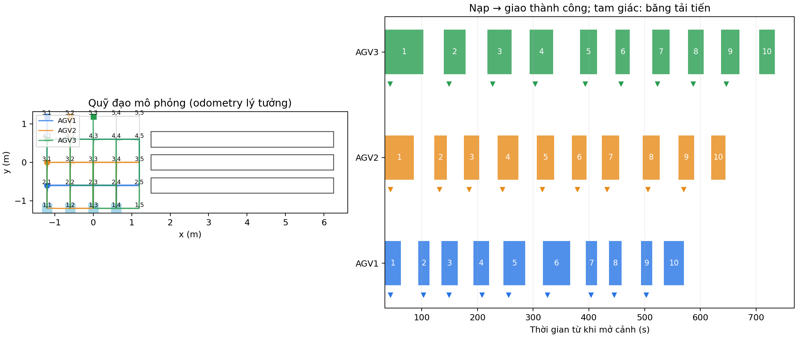

# Kiểm chứng sửa kẹt ba xe — 24/10/2026

Đã chạy Gazebo, ba Nav2 và ba camera tổng hợp với lịch `demo30`, không dùng
`--sync-rounds`. Ba xe hoạt động độc lập: giao xong trở về điểm quan sát của
dãy riêng, lấy kiện tiếp; chỉ đi đỗ sau kiện thứ mười.

## Lỗi đã xác định

Log người dùng tại `/home/tai/agv_logs/warehouse_3agv_20261024_142545` cho thấy
vòng chờ ba xe: AGV1 ở (2,4) bị AGV3 tại (2,3) chắn, AGV2 tại (1,4) cần đi qua
(2,4), AGV3 đợi AGV2 rời trạm. Bộ gỡ kẹt từng cặp ghi đè lộ trình AGV1 hai lần
trong cùng chu kỳ; lệnh mới hủy bước xoay trước khi xe kịp rời ô. Việc tìm chỗ
nhường còn thiếu vị trí xe thứ ba.

Trong lượt thử sửa tiếp theo (`warehouse_continuous30_recovery_20261024_v2`),
AGV2 được quyền giao nhưng xe chờ đỗ tại (2,1), chắn cửa vào trạm (1,1).
Sau khi nhường sang bên, AGV2 không khôi phục được lộ trình vì xem xe chờ là
vật cản cứng; cả đội đứng yên. Lượt đó thất bại do hết thời gian, không được
tính là kết quả đạt. Lượt `v1` được chủ động dừng để bổ sung sửa lỗi, cũng
không được tính hoàn thành.

## Cách sửa

- Xét cả xe thứ ba khi tìm đường vòng và chỗ nhường; chỉ cho một phương án
  phục hồi có hiệu lực trong lúc xe xác nhận, xoay và rời ô đang chắn, tối đa
  12 giây trước khi đánh giá lại.
- Giữ các ô đã cấp theo lệnh cũ tới khi có xác nhận lệnh thay thế. Lệnh đích
  mới và lệnh thử lại không cắt ngang bước nhường đang thực hiện.
- Không bố trí chỗ đỗ chờ tại hàng 2; đặt xe chờ phía sau hàng hiện tại của
  xe đang được quyền giao. Xe đã nhường khôi phục đích dưới cơ chế giữ ô;
  nếu còn xe đỗ chắn lối, bộ điều phối tiếp tục xử lý xe chắn đó.
- Trạng thái xác nhận có đích và chế độ lộ trình; không nhầm một lộ trình
  nhường với lệnh giao hàng đã được nhận hoặc đã hoàn thành.

Các ca tái hiện vòng chờ, ô nhường có xe thứ ba, quyền ô cũ tới khi xác nhận,
lệnh đích trong lúc nhường và chỗ chờ chắn cửa vào được lưu trong
`tests/test_traffic_three_robot_recovery.py` và `tests/test_warehouse_continuous.py`.
Toàn bộ bộ kiểm tra: **145 ca đạt**.

## Kết quả lượt chạy đầy đủ trên bản sửa cuối

```bash
./tools/warehouse_sim.sh up --scenario demo30 --autostart --exit-on-complete \
  --out /home/tai/agv_logs/warehouse_continuous30_recovery_20261024_v3
python3 tools/warehouse_report.py \
  /home/tai/agv_logs/warehouse_continuous30_recovery_20261024_v3
```

| Chỉ tiêu | Kết quả từ log |
|---|---|
| Kiện giao thành công | 30/30; mỗi xe 10/10 |
| Kiện rời băng tải nhận | 30/30 |
| Chốt camera, phân đúng loại | 30/30 |
| Cấp kiện kế tiếp sau khi xe đã lấy hàng và rời vùng nạp | 27/27 |
| Sai FIFO, giao sai ô, quyền ô giao bị cấp trùng trong kiểm tra sự kiện | 0 |
| Đích dừng riêng tại ô giao trừ một | 0 |
| Quay về ô quan sát lấy tiếp | Mỗi xe 9 lần; (2,4), (3,4), (4,4) tương ứng |
| Rào đồng bộ các xe | Không |
| Thời gian bắt đầu nhiệm vụ → cả ba đỗ xong | 746,754 giây |
| Khoảng cách tâm hai xe nhỏ nhất được ghi nhận | 0,590291 m |
| Cảnh báo hai tâm xe gần dưới 0,26 m | 0 |
| Lỗi nhiệm vụ hoặc mất dữ liệu | 0 |



Số trên thanh là thứ tự kiện của từng xe. Các thanh diễn ra xen kẽ, không có
đợi cả đội lấy hoặc giao xong rồi mới bắt đầu lượt kế tiếp. Khoảng trống giữa
hai thanh bao gồm đường về, đo và tiếp cận lấy hàng, không chỉ thời gian chờ.

Nguồn đối chiếu: [sự kiện](events.jsonl), [kết quả kiểm tra](audit.json),
[tóm tắt](summary.json), [quỹ đạo](trajectories.csv), [log điều phối](traffic.log).
`code_sha256.json` ghi mã băm các file điều khiển tại lượt chạy. Toàn bộ tiến
trình của lượt thử đã được đóng sau khi hoàn thành; log vẫn được giữ.

Đây là **một lượt chạy thành công trong mô phỏng động học**, với odometry lý
tưởng, Nav2 thật, RGB và LiDAR do chương trình sinh, không mô phỏng động lực
học tiếp xúc. Không dùng các số trên làm kết quả đo xe thật, chứng minh tối ưu
thời gian toàn cục hoặc bảo đảm mọi lịch hàng khác đều không kẹt.
