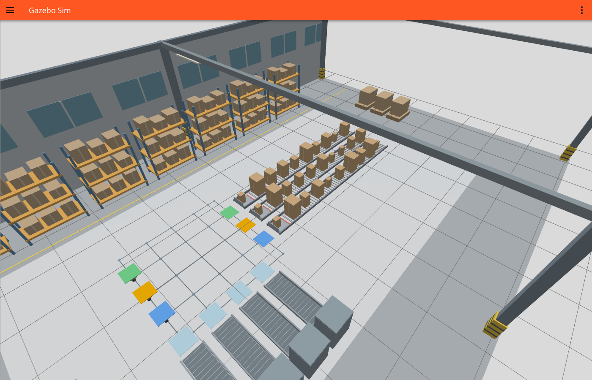
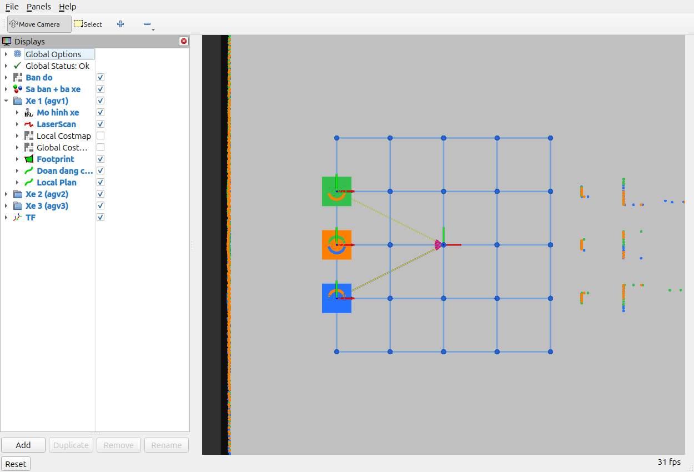

# RViz, cảnh nhà xưởng và cơ cấu cấp hàng — 24/10/2026

```bash
cd /home/tai/Robot_kho_clone
./tools/warehouse_sim.sh up --scenario demo30
```

Đợi `Ready`, chọn cửa sổ camera và bấm **Space**. Lệnh mở Gazebo, RViz và camera
cùng một phiên mô phỏng. Ctrl+C hoặc `./tools/warehouse_sim.sh down` đóng toàn
bộ tiến trình của phiên đó. `--no-rviz` tắt việc mở RViz; `--headless` bỏ các GUI.

RViz lấy bố cục từ `tools/fleet.rviz`, có ba nhóm AGV, bản đồ, lưới, mô hình,
LiDAR, footprint và đường đi. Các lớp Local/Global Costmap có sẵn nhưng mặc
định tắt để dễ nhìn lưới. Các khung TF, đường cục bộ và dữ liệu costmap được
đổi tên riêng cho từng xe trong phần hiển thị; không sửa dữ liệu Nav2 gốc.
Không thêm hạt AMCL: phiên mô phỏng đang dùng odometry lý tưởng.

Cảnh xung quanh có kệ hàng, pallet, xe nâng đỗ, cột bảo vệ, cửa sổ, tủ điện,
đèn và vạch người đi bộ. Chúng nằm ngoài phòng đã lập bản đồ và chỉ minh họa
nhà xưởng; không phải vật cản mới được thêm vào bộ sinh LiDAR. Vùng chạy vẫn
là sa bàn 5 × 5, cùng ba dãy cấp và bốn trạm nhận.





Ảnh chụp trực tiếp ở phiên đứng yên `warehouse_factory_preview_20261024_v2`,
lịch đầu vào 30 kiện, chưa bấm bắt đầu. TF được bật trong ảnh để kiểm tra các
khung; mặc định mở phiên mới thì lớp TF tắt. Điểm LiDAR mang màu xe đang quét,
nên các điểm đo trên thân xe khác có thể khác màu thân xe đó.

## Sửa phần thanh đỏ

Chu trình nạp 2 giây được tách thành các chuyển động có thứ tự:

1. Hạ chốt chặn dưới mặt đỡ; thanh đẩy nâng lên ở phía sau bàn nâng.
2. Bàn nâng đưa kiện đầu từ cao độ 6 cm lên 16 cm; cầu nối gập mở sang sàn xe.
   Thanh đẩy tiếp cận mặt sau kiện sau khi đã ở trên mặt bàn.
3. Đẩy kiện trên mặt đỡ tới sàn xe. Vị trí tiếp xúc theo mặt sau kiện đang
   nạp, không dùng một hành trình cố định cho mọi kích thước.
4. Tay theo gập ngang sang bên trước khi thanh đỏ hạ xuống. Thanh đỏ nằm
   hoàn toàn dưới mặt băng tải, sau đó rút về; cầu nối gập lại và bàn nâng hạ.
5. Chỉ khi nạp xong và xe rời vị trí lấy hơn 0,42 m, hàng đợi mới tiến lên.

Thanh và tay theo khi nghỉ đều ở trên sàn, dưới mặt đỡ 6 cm. Đầu băng tải có
bàn nâng riêng thay cho các con lăn tại cùng vị trí; chân đỡ hai bên chừa lối
rút thanh đẩy bên dưới. Cầu nối gập quanh bản lề, không biến mất dưới nền.

## Kiểm chứng

- **146 ca kiểm tra đạt**. Ca kiểm tra cơ cấu quét 401 thời điểm nạp cho từng
  cặp trong 16 tổ hợp kích thước trước–sau, kiểm tra phần thanh, tay theo, kiện,
  bàn nâng, chốt và bao hình cầu nối; kiểm tra tiếp hành trình đưa kiện sau lên.
- Chạy Gazebo + RViz + ba Nav2 + ba camera với lịch AGV1 `T1,T4`, AGV2 `T2,T1`,
  AGV3 `T3,T2`: **6/6 kiện hoàn thành**, mỗi xe hai kiện; băng tải nhận giải
  phóng đủ sáu kiện, không sai FIFO hoặc giao sai loại trong kiểm tra sự kiện.
- Thời gian nhiệm vụ của lượt này: **186,052 giây**; khoảng cách tâm nhỏ nhất
  **0,590840 m**; không có cảnh báo hai tâm gần dưới 0,26 m.
- Log RViz của lượt chạy không có lỗi shader bản đồ hoặc bỏ dữ liệu do thiếu TF.
  Bản sửa shader được đặt trong thư mục tài nguyên riêng của phiên, không sửa
  file cài ROS trong `/opt/ros`.

Lệnh kiểm chứng:

```bash
./tools/warehouse_sim.sh up --orders 'agv1:1,4;agv2:2,1;agv3:3,2' \
  --autostart --exit-on-complete \
  --out /home/tai/agv_logs/warehouse_factory_rviz_20261024_v3
```

Nguồn: [sự kiện](events.jsonl), [audit](audit.json), [summary](summary.json),
[log RViz](rviz.log), [quỹ đạo](trajectories_and_deliveries.png).
Đây là lượt sáu kiện kiểm tra thay đổi hiển thị/cơ cấu, không được ghi là một
lượt mới hoàn thành 30 kiện. Kết quả 30 kiện trước đó được lưu riêng ở
`../warehouse_continuous30_validation/`.

Mô hình vẫn là động học, không giải va chạm/ma sát hoặc tải trọng trong Gazebo.
Kiểm tra khoảng hở hình học không thay thế thiết kế cơ khí và thử tải thực tế.
