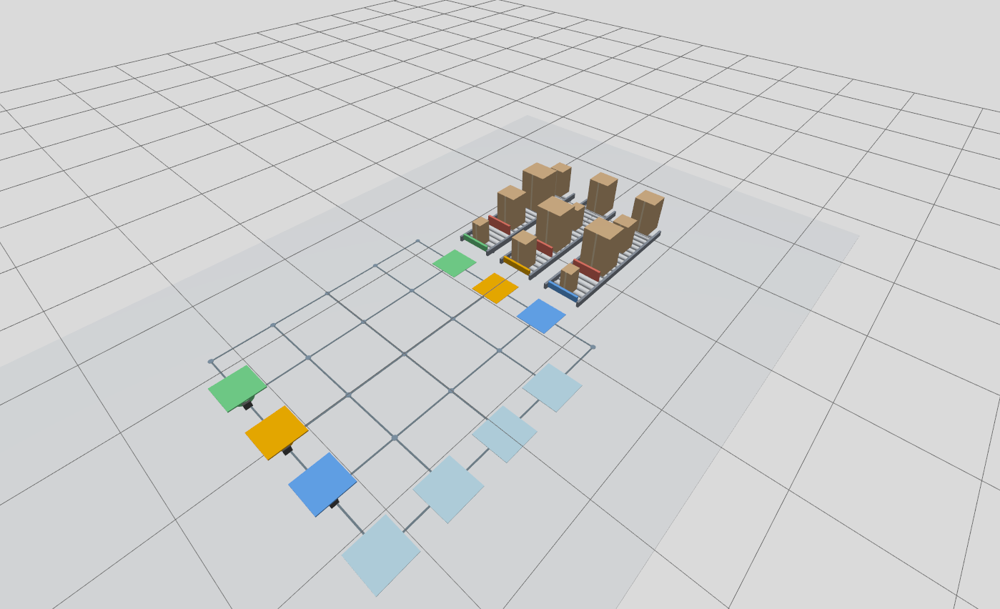
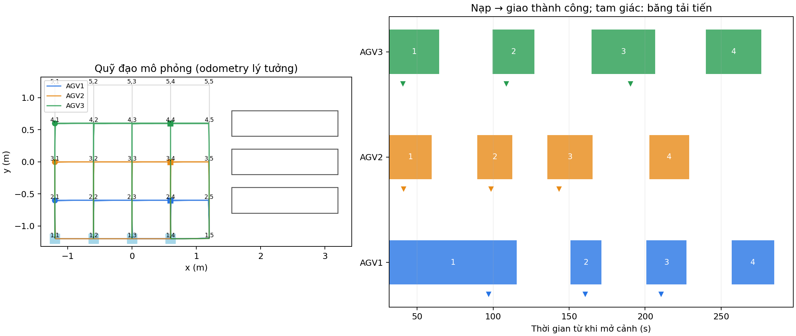
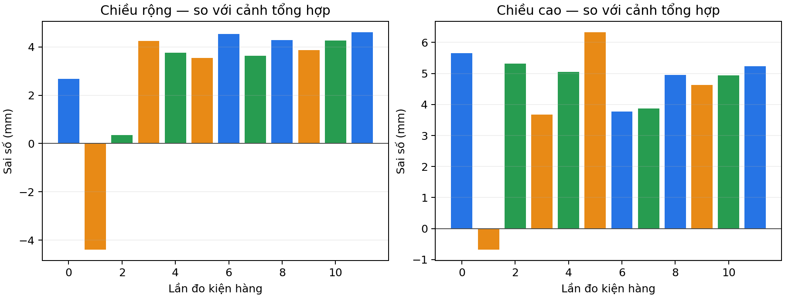
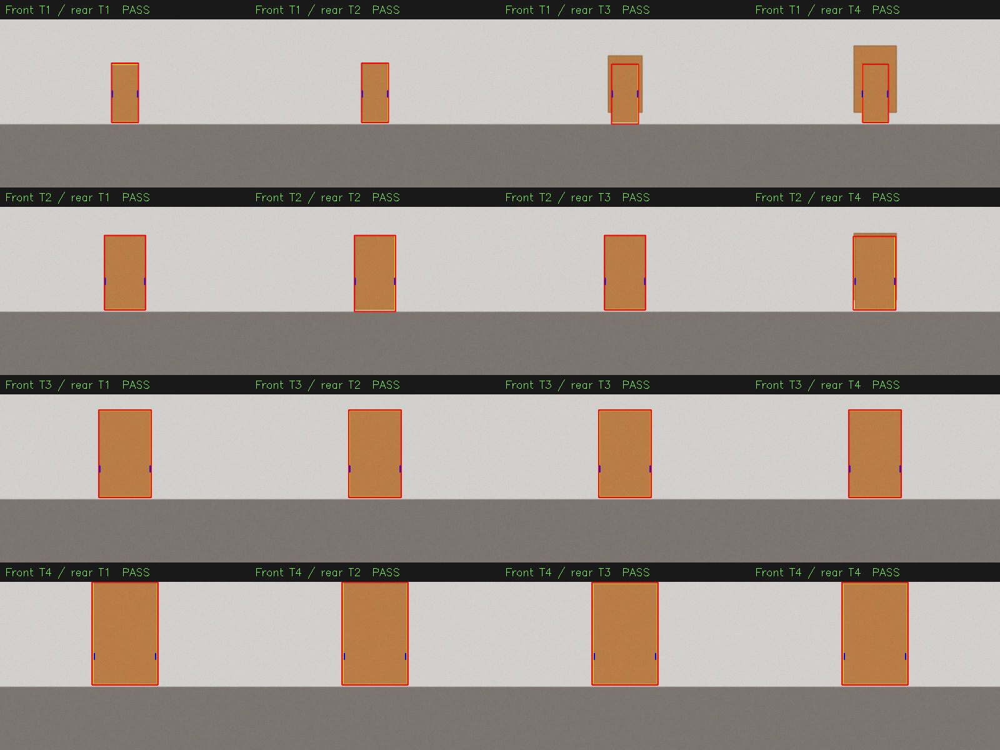

# Kết quả mô phỏng ngày 24/10/2026

Đây là **kết quả chạy chương trình mô phỏng**, không phải số liệu đo xe hoặc
cơ cấu cấp hàng thật. Cảnh Gazebo được cập nhật theo động học; cảm biến RGB
và LiDAR được sinh riêng bằng chương trình.

Lượt kiểm chứng lưu tại đây sử dụng ngưỡng phân loại **24–50 cm**. Sau đó,
dải phân loại trong chương trình được đổi thành **22–50 cm**, với các mốc
22, 29, 36, 43 và 50 cm theo yêu cầu người dùng. Không chạy lại mô phỏng;
các log, ảnh và số liệu dưới đây vẫn thuộc phiên dùng cấu hình cũ.



*Ảnh chụp trực tiếp từ Gazebo ở trạng thái đầu: mỗi dãy có bốn kiện khác cỡ,
có con lăn, chốt chặn và bàn đẩy. Ba xe đứng ở các ô (2,1), (3,1), (4,1).
Ảnh bố trí được chụp ở phiên `warehouse_3agv_20261024_preview`; số liệu vận
chuyển bên dưới thuộc phiên chạy đủ 12 kiện `warehouse_3agv_20261024_final`.*

Lệnh của lượt chạy đầy đủ:

```bash
./tools/warehouse_sim.sh up --autostart \
  --out /home/tai/agv_logs/warehouse_3agv_20261024_final
```

Thông số: lưới 5 × 5 bước 0,60 m; ba xe; mỗi dãy bốn kiện; vận tốc đặt
0,22 m/s; odometry lý tưởng; trễ truyền động 0,02 s; hằng số quán tính 0,06 s;
LiDAR 720 tia/vòng, nhiễu khoảng cách Gaussian σ = 1 mm. Camera 640 × 480,
có méo xuyên tâm, Gaussian blur, nhiễu RGB σ = 3 mức xám và JPEG chất lượng 80.
Các tham số này là giả thiết mô phỏng.

| Chỉ tiêu | Kết quả quan sát | Nguồn |
|---|---|---|
| Kiện giao thành công | 12/12; mỗi xe 4/4 | `events.jsonl`, `audit.json` |
| Đúng thứ tự lấy và giao FIFO | 3/3 dãy | `audit.json` |
| Kiện được phân đúng loại theo chiều cao | 12/12 | `summary.json`, `vision_measurements` |
| Số lần cấp kiện tiếp theo | 9/9; mỗi dãy 3 lần | `events.jsonl`, `audit.json` |
| Cấp kiện sau khi đã nạp và xe cách điểm lấy > 0,42 m | Đủ 9 lần; không có vi phạm kiểm tra | `events.jsonl`, `audit.json` |
| Thời gian từ bắt đầu nhiệm vụ đến khi giao hết và quay về | 293,402 s | Hiệu mốc `mission_complete` và `mission_started` |
| Khoảng cách nhỏ nhất giữa tâm hai xe | 0,59137 m | `summary.json` |
| Cảnh báo hai tâm xe gần dưới 0,26 m | 0 | `summary.json` |
| Sai lệch rộng lớn nhất của 12 kết quả trung bình 5 ảnh | 4,60 mm | So với hình học đầu vào trong `summary.json` |
| Sai lệch cao lớn nhất của 12 kết quả trung bình 5 ảnh | 6,32 mm | So với hình học đầu vào trong `summary.json` |

Thời gian trên là **một lượt chạy trên laptop này**, có cả thời gian dừng,
chờ ô giao, chờ đường, đo và quay về; không phải giá trị trung bình nhiều lượt.
Không suy ra độ tin cậy ngoài thực tế hoặc khả năng tránh mọi va chạm từ một lượt chạy.



*Quỹ đạo được dựng từ `trajectories.csv`. Mỗi thanh biểu diễn khoảng từ bắt đầu
nạp tới giao thành công; số trắng là số thứ tự kiện trong dãy, tam giác là lúc
băng tải bắt đầu đưa hàng lên. Các lượt quay về và chờ không nằm trong thanh giao.*



## Thử riêng việc không gộp kiện phía sau

```bash
./tools/warehouse_sim.sh vision-check \
  --out /home/tai/agv_logs/warehouse_vision_20261024
```

Đủ 16 cặp loại trước–sau, mỗi cặp thử ba độ lệch ngang 0 và ±25 mm:
**48/48 ca phân đúng kiện trước**, đồng thời sai lệch rộng/cao đều dưới ngưỡng
kiểm tra 15 mm. Sai lệch tuyệt đối lớn nhất: rộng **11,85 mm**, cao **12,17 mm**.
Đây là số đo từng ảnh với LiDAR hình học không nhiễu, khác phép chạy vận chuyển
có nhiễu LiDAR và chốt trung bình năm ảnh ở trên. Ca ảnh không có đường bao
phù hợp mặt trước LiDAR được từ chối (`ambiguous_refused: true`).



*Hàng: loại kiện phía trước T1–T4; cột: loại kiện phía sau T1–T4. Hình minh họa
16 ca không lệch ngang; 32 ca lệch ngang còn lại có kết quả trong `vision_results.json`.
Các kiện cùng màu, đường mép tối là chi tiết đồ họa của vật thể, không phải màu
hay mã dùng để phân loại. Không coi đây là kiểm chứng với ảnh camera thật.*

## Câu viết có thể đưa vào báo cáo

“Trong một lượt mô phỏng ba robot với ba hàng đợi độc lập, hệ thống hoàn thành
12 lượt giao, mỗi robot vận chuyển lần lượt bốn kiện thuộc bốn nhóm chiều cao.
Thứ tự lấy và giao phù hợp FIFO; chín lần cấp kiện kế tiếp đều xảy ra sau khi
robot đã nhận kiện và rời vùng lấy hàng. Bộ điều phối quản lý việc sử dụng chung
các ô giao theo loại. Phép thử ảnh tổng hợp gồm 48 trường hợp kết hợp kiện
trước–sau và độ lệch ngang đều phân đúng kiện đầu hàng; trường hợp không có đủ
bằng chứng đường bao bị từ chối đo. Kết quả kiểm chứng logic điều phối và xử lý
ảnh trong các điều kiện mô phỏng đã nêu, chưa thay thế thử nghiệm cảm biến,
định vị và cơ cấu vận chuyển trên hệ thống thật.”

Các file JSON/CSV ở đây là bản sao từ thư mục log trên laptop. `summary.json`
ghi thời gian tồn tại cảnh; khi cần thời gian nhiệm vụ, dùng chênh lệch hai mốc
sự kiện hoặc trường `mission_duration_s` trong `audit.json`.
