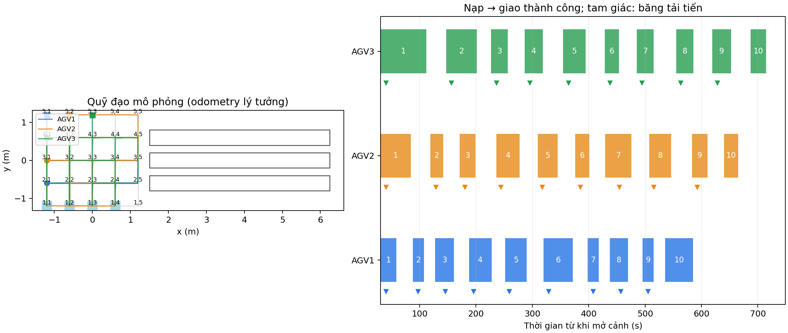

# Sửa đường vòng và đổi đích ở lượt lấy đầu — 24/10/2026

**Lượt kiểm chứng lịch sử:** cách chọn các ô chờ rời rạc dưới đây đã được
thay bằng hàng nối đuôi trên cùng cột giao theo yêu cầu làm rõ sau đó. Không
dùng kết quả 30 kiện trong trang này để khẳng định bản hàng nối đuôi mới đã
được kiểm chứng; xem phần mô tả hiện tại trong tài liệu mô phỏng chính.

Log người dùng: `/home/tai/agv_logs/warehouse_3agv_20261024_160757`.
Ba camera đo đúng và ba xe đều nạp kiện đầu. Biểu hiện lỗi xảy ra khi đi
giao: AGV1 được giao chỗ chờ (5,1), sau đó (3,1), rồi chuyển sang trạm (1,1)
khi chưa tới (3,1). AGV2 lần lượt nhận (5,2), (5,1), (3,1). Lệnh thay thế
khi xe mới đi một phần cạnh khiến bộ tìm đường lấy ô gần nhất phía sau làm
điểm bắt đầu; xe quay lại ô đó trước khi tiếp tục. Đây là đường vòng và thay
đích không cần thiết, không phải lỗi lấy hàng hoặc camera.

Nguồn gốc là quy tắc chặn tất cả cột của các hàng phía trước xe đang giao,
kết hợp chọn ô chờ chỉ theo độ gần trạm và cho phép tiến ô chờ liên tục.

## Thay đổi

- `tools/delivery_queue.py`: khi có vị trí xe, xếp hạng ô chờ theo tổng số
  cạnh từ xe qua chỗ chờ tới trạm, rồi góc quay ước lượng và khoảng còn lại.
  Thứ tự phục vụ vẫn FIFO; chỗ chờ của các xe không trùng nhau.
- `tools/warehouse_scene.py`: chừa hàng ngang xe đang rời điểm lấy và cột
  tiếp cận trạm, thay vì loại cả vùng hàng/cột. Giữ hàng 2 thông thoáng.
- Hoàn tất lộ trình ngắn tới chỗ chờ trước khi đổi sang đích giao; không
  chuyển qua nhiều ô chờ khi trạm còn bận. Bỏ yêu cầu xoay về hướng Nam riêng
  tại chỗ chờ; hướng cuối tại trạm giao vẫn là Nam.
- Kiểm tra hồi quy gồm thay đích giữa cạnh, giữ chỗ chờ ổn định, và cả ba
  khả năng AGV1/AGV2/AGV3 nhận quyền giao đầu tiên.

Phần sửa lần này nằm ở điều phối nhiệm vụ mô phỏng; không sửa firmware,
GPIO, PID hoặc chương trình vận hành camera xe thật.

## Lượt kiểm chứng hoàn chỉnh

```bash
./tools/warehouse_sim.sh up --scenario demo30 --headless --autostart \
  --exit-on-complete \
  --out /home/tai/agv_logs/warehouse_queue_smooth30_20261024_v1
python3 tools/warehouse_report.py \
  /home/tai/agv_logs/warehouse_queue_smooth30_20261024_v1
```

Chạy Gazebo server, ba Nav2 và ba camera tổng hợp; không mở các cửa sổ GUI.
Không dùng rào đồng bộ giữa các xe. Kết quả từ chính lượt chạy này:

| Chỉ tiêu | Kết quả |
|---|---|
| Kiện giao thành công | 30/30; mỗi xe 10/10 |
| Kiện rời băng tải nhận | 30/30 |
| Chốt camera | 30 lần |
| Đẩy kiện tiếp sau khi nạp và rời vùng lấy | 27 lần |
| Lộ trình tới ô chờ bị thay trước khi tới nơi | 0 |
| Lỗi FIFO, phân loại, ô giao hoặc quyền trạm trong audit | 0 |
| Thời gian bắt đầu → giao kiện cuối | 706,852 giây |
| Thời gian bắt đầu → cả ba đỗ xong | 727,502 giây |
| Khoảng cách tâm xe nhỏ nhất ghi nhận | 0,590255 m |
| Cảnh báo khoảng cách tâm dưới 0,26 m | 0 |
| Bộ kiểm tra tự động | 148/148 đạt |

Ở lượt này, AGV1 vào giao trước; AGV2 chỉ tới một ô chờ (3,1), AGV3 chỉ tới
một ô chờ (3,2) trước lần giao đầu. Thứ tự xe vào trạm khác lượt người dùng,
và lượt kiểm chứng không mở GUI, nên không dùng hai lượt này để kết luận một
tỷ lệ tăng năng suất chung. Xe vẫn có thể phải chờ ô đường hoặc trạm đang
bận; khi trạm được giải phóng giữa lúc đang tới chỗ chờ, xe hoàn tất đoạn đó
rồi mới nhận đích giao. Chưa chứng minh tối ưu toàn cục về thời gian.

Đây là mô phỏng động học với odometry lý tưởng, không phải phép đo trên xe
thật hoặc mô phỏng va chạm và tải trọng cơ khí.

Nguồn: [sự kiện](events.jsonl), [audit](audit.json), [summary](summary.json),
[quỹ đạo gốc](trajectories.csv), [log điều phối](traffic.log),
[đối chiếu thay đích](route_changes.json), [mã băm](code_sha256.json).
Log trước sửa được giữ ở [before_events.jsonl](before_events.jsonl) và
[before_traffic.log](before_traffic.log); lượt đó được chủ động dừng, không
được ghi là hoàn thành 30 kiện.



Mở lại bản có giao diện:

```bash
cd /home/tai/Robot_kho_clone
./tools/warehouse_sim.sh up --scenario demo30
```

Đợi `Ready`, bấm Space trong cửa sổ camera. Phiên kiểm chứng đã tự đóng toàn
bộ tiến trình khi hoàn thành; không còn mô phỏng chạy ngầm.
